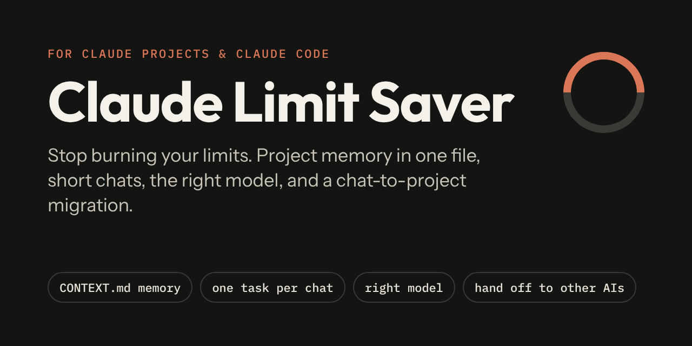
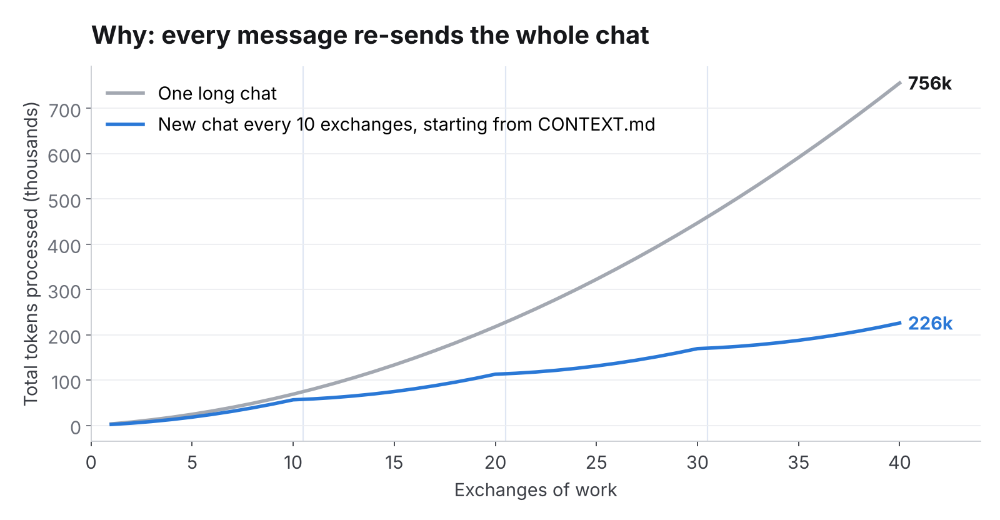
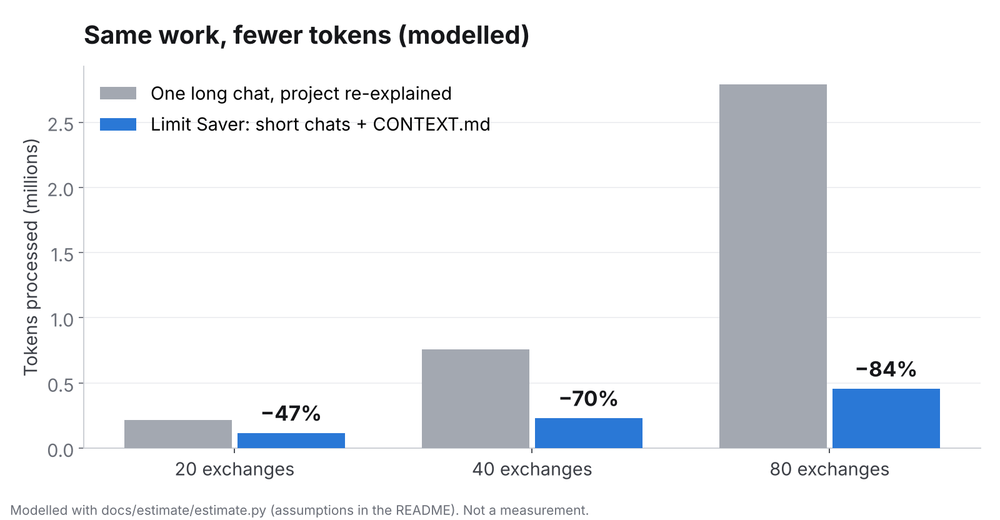
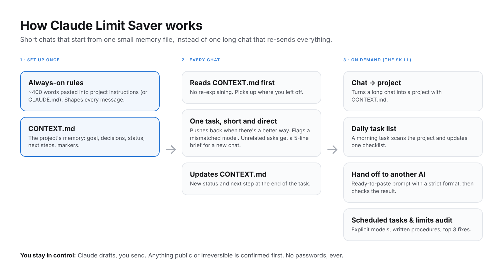

<p align="center">
  
</p>

<p align="center">
  <a href="LICENSE"></a>
  <a href="../../releases/latest"></a>
  
  
</p>

# Claude Limit Saver

**Stop burning your Claude limits.** A ~400-word rules file you paste into your project, plus one skill.
Together they keep project memory in a small file, keep chats short, flag when you're on the wrong model,
give you a daily task list, and turn a messy chat into a proper project.

Made for people running real work on a basic plan, not just developers.

**Contents:** [Why](#why-your-limit-runs-out) · [How much it saves](#how-much-it-saves) ·
[What changes](#what-changes) · [How it works](#how-it-works) · [Set up in 5 minutes](#set-up-in-5-minutes) ·
[What's inside](#whats-inside) · [Daily task list](#the-daily-task-list) · [FAQ](#faq) · [Contributing](#contributing)

---

## Why your limit runs out

Every message you send re-sends the whole chat so far, so a chat that's twice as long costs roughly
**four times** as much in total. Re-explaining your project at the start of every chat adds more.

<p align="center"></p>

Limit Saver keeps each chat short and starts it from one small memory file (`CONTEXT.md`). The same work,
far less re-sending.

## How much it saves

<p align="center"></p>

**Modelled estimate: about 47–84% fewer tokens processed for the same work (≈70% for a typical
40-exchange day).** The longer your chats are today, the bigger the saving.

| Assumption (change them in [`estimate.py`](docs/estimate/estimate.py)) | Value |
|---|---|
| Average exchange (your message + Claude's reply) | 800 tokens |
| Re-explaining the project at the start of a chat (without) | 2,500 tokens |
| Rules + CONTEXT.md loaded in every chat (with) | 1,250 tokens |
| Exchanges per chat with "one task per chat" | 10 |
| Daily task list run (with) | 3,400 tokens/day |

**Read this before quoting the number:**
- It's **arithmetic, not a measurement.** It assumes the same work gets done. Output quality wasn't
  measured, and the skill is designed to keep it the same (same context, less repetition).
- Claude's apps don't publish exactly how usage limits are counted, and caching can make long chats
  cheaper than this model suggests. **Real limit savings will usually be smaller** than tokens processed.
- Model choice (lighter models for routine work) can save more on top, but isn't included.
- Measure your own in one week: [`docs/measure-it.md`](docs/measure-it.md). Share your numbers in an
  issue, and real results will replace this estimate.

## What changes

| Without | With Limit Saver |
|---|---|
| You re-explain your project at the start of every chat | Claude reads `CONTEXT.md` and picks up where you left off |
| One giant chat that gets slower and more expensive every message | Unrelated requests get a 5-line brief to paste into a fresh chat |
| The heaviest model formats a list | Claude says in one line when the task needs a lighter (or heavier) model |
| A scheduled task quietly runs every day on the default model | Every scheduled task gets an explicit model, a written procedure and a short report |
| You open a new chat each morning to ask "what's next?" | A morning task scans the project and updates one checklist you tick through |
| The same parked idea or warning comes back every chat | `PARKED`, `DELIBERATE` and `FINISHED` markers stop it |
| Claude does exactly what you typed, even when there's a better way | It says so in one line and gives you the better prompt first |
| Claude struggles with a long web-research job | It hands you a ready-to-paste prompt for your other AI tool, then checks the result |

## How it works

<p align="center"></p>

1. **Always-on rules** ([`PROJECT-INSTRUCTIONS.md`](skills/limit-saver/rules/PROJECT-INSTRUCTIONS.md)) change
   Claude's behaviour in every message: memory file first, push back when it matters, one task per chat,
   a model check only when the model doesn't fit, brief answers, ask instead of work around, best tool for the job,
   respect the markers, and you stay in control.
2. **`CONTEXT.md`** ([template](skills/limit-saver/templates/CONTEXT.md) ·
   [filled example](skills/limit-saver/examples/CONTEXT-example.md)) is the project's memory.
3. **The `limit-saver` skill** loads only when needed, for jobs with steps:

| You say | It does |
|---|---|
| "Turn this chat into a project" | Inventories the chat, writes CONTEXT.md, tells you exactly what to click |
| "Use the same rules as my other project" | Merges the rules and lists what was copied |
| "Run this every morning" | Writes a procedure, picks an explicit model, records the task |
| "Give me a daily to-do list" | Sets up the [daily task list](#the-daily-task-list) |
| "Can ChatGPT do this?" | One-line reason + a strict ready-to-paste prompt, then checks the result |
| "I keep hitting my limit" | A 5-minute audit with your top 3 fixes |

## Set up in 5 minutes

### Claude Projects (claude.ai), no code
1. Open [`PROJECT-INSTRUCTIONS.md`](skills/limit-saver/rules/PROJECT-INSTRUCTIONS.md), copy everything below
   the line, fill in the `<...>` parts and paste it into your project's **instructions**.
2. Copy [`CONTEXT.md`](skills/limit-saver/templates/CONTEXT.md), fill in what you know (or ask Claude:
   *"fill this in from our chat"*), and add it to the project's **knowledge**.
3. Optional, for the procedures: download **`limit-saver.zip`** from the
   [latest release](../../releases/latest) and upload it as a skill in Claude's settings, if your plan supports skills.
4. **Test it:** start a new chat in the project and type *"What's the next step?"* Claude should answer from
   CONTEXT.md without asking you to explain the project.

### Claude Code
```bash
git clone https://github.com/louddesigns99-ui/claude-limit-saver
cp -r claude-limit-saver/skills/limit-saver ~/.claude/skills/
```
In your project, save the rules (below the line in `PROJECT-INSTRUCTIONS.md`) as `CLAUDE.md` and add a
`CONTEXT.md` from the template.

### Already in a long chat?
Type **"Turn this chat into a project."**

## What's inside
```
skills/limit-saver/
├── SKILL.md                      # when to use which procedure (~300 words)
├── rules/PROJECT-INSTRUCTIONS.md # the always-on rules you paste in
├── references/
│   ├── chat-to-project.md        # migrate a chat; copy rules between projects
│   ├── scheduled-tasks.md        # scheduled tasks that don't drain your limit
│   ├── daily-task-list.md        # morning task that updates one checklist
│   ├── handoff.md                # hand a step to another AI, then check it
│   └── limits-audit.md           # "I keep hitting my limit" → top 3 fixes
├── templates/                    # CONTEXT.md, TASKS.md, handoff prompt
└── examples/                     # filled CONTEXT.md (fictional), handoff examples
docs/
├── measure-it.md                 # one-week before/after method
├── estimate/                     # the token model and chart scripts
└── img/                          # README images
```

## The daily task list
A scheduled task runs each morning (default-tier model). It reads CONTEXT.md, your trackers and anything
new, then updates **one checklist**: yesterday's open items carried over, ticked ones moved to "Done",
new items added in priority order with an owner (`[me]`, `[Claude]`, `[other AI]`) and where to do each
one. Ten open items max. Your ticks always win, and it never invents deadlines.
Template: [`TASKS.md`](skills/limit-saver/templates/TASKS.md) ·
Procedure: [`daily-task-list.md`](skills/limit-saver/references/daily-task-list.md).

## FAQ
**Will Claude get worse answers with shorter chats?** It shouldn't. CONTEXT.md carries what matters
between chats, and the rules make Claude read it first. If something important keeps getting lost, it
belongs in CONTEXT.md.

**Can it switch models for me?** No. Claude can't switch its own model. It tells you when the model
doesn't fit the task, and you switch.

**Does it send emails or post for me?** No. It drafts; you approve. Anything public or irreversible is
confirmed first. It never handles passwords or payment details.

**Do I need to code?** No. The claude.ai setup is copy and paste.

**Which plans?** Any. The skill upload needs a plan with skills; the rules file works everywhere.

## Contributing
Before/after reports, rule fixes and short new procedures are welcome. See [CONTRIBUTING.md](CONTRIBUTING.md).
Keep the always-on rules under ~400 words, because they load on every message.

## Support
If this saves you time, a ⭐ helps others find it. Want to say thanks? Use the **Sponsor** button at the top of the repo.

## License
[MIT](LICENSE)
